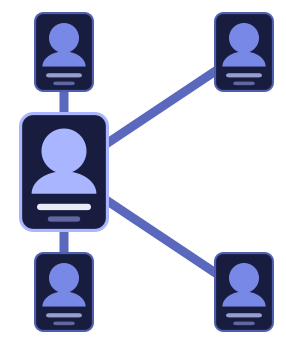

<p align="center">
  
</p>

<h1 align="center">Kintion</h1>

<p align="center"><b>Relationships have history.</b></p>

[English version](README.md)


## Что это

Kintion — self-hosted сервис для людей, связей между ними и событий во времени. Первое, что он умеет хорошо, — семейные деревья, но «отношение» здесь шире родства: брак, дружба, работа, учёба, членство в сообществе. Запускается у вас: Docker Compose, PostgreSQL и локальный том для фотографий. Без облака и телеметрии.

## Почему

Всё началось с простого желания — нарисовать свою семью. Я перебрал существующие self-hosted инструменты, и каждый закрывал только часть задачи. В одном был приятный интерфейс и свои типы связей, но у отношений не было дат. В другом у отношений были даты начала и конца, но бедная карточка человека и нельзя настроить свои типы связей. Генеалогические программы заточены под предков: нет нормального полного дерева, а отношения ограничены классикой «родитель — ребёнок — супруг». Третьи выглядели многообещающе, пока живой интерфейс не показал, что отношения в них недоделаны.

За этим стоит закономерность. Инструменты предлагают либо хорошую записную книжку без временной модели отношений, либо хорошую генеалогию без произвольных социальных связей, либо гибкий граф без удобной модели людей и их истории. Мне нужно было всё сразу, потому что жизнь — не линия между двумя людьми: человек меняет фамилию; пара встречается, потом помолвлена, потом женаты, потом разведены; отношение может объединять троих и больше, у каждого участника свой период участия; одно событие может начать, закончить или изменить отношение — свадьба заодно меняет фамилию, у неё есть свидетели и гости; одна дата известна как «12 марта», другая — как «где-то в 1985-м».

Ни одно найденное решение не моделировало отношение как полноценную историческую сущность, поэтому Kintion начинается именно с этого. **Отношение — самостоятельная запись**: участники, роли, этапы, даты, история. **Поле — список значений**, а не значение; верхнее — просто текущее. **Дата может быть частичной**, и неизвестная часть остаётся неизвестной, а не додумывается. Всё, что меняется, попадает в подробный журнал. А поскольку «что такое семья» у разных людей и культур разное, знания о предметной области вынесены из кода в **паки**, которые можно читать, переводить и расширять.

## Как поставить

Нужны Docker и Compose v2.

```sh
cd deploy                              # из корня репозитория
cp .env.example .env                   # задайте TEO_KIN_DB_PASSWORD
docker compose up -d --build
docker compose logs app | grep bootstrap_token
```

Dockge / Portainer без клонирования репозитория — [готовый compose](docs/deployment.md#dockge--portainer-without-cloning) (на английском).

Откройте <http://localhost:8080>, введите токен настройки из лога, логин и пароль владельца. Порты, настройки, обновление, бэкап и восстановление — в [docs/deployment.md](docs/deployment.md) (на английском).

## Чем отличается

- **Отношения со своей жизнью.** У брака есть этапы, участники с ролями по полу (Муж / Жена, Жених / Невеста), начало, конец и событие, которым он закончился, — а не просто линия на схеме.
- **Ничего не затирается.** У каждого поля сохраняется история в порядке, который задаёте вы; «Василькова (Иванова)» в узле дерева — просто первая и текущая фамилии.
- **Даты так, как их знают.** `1985`, `март 1985`, `12 марта` — год, месяц и день независимы, и тип понимает их на уровне базы.
- **Журнал всего** с первой версии: кто, что и с какого значения на какое изменил.
- **Предметная область — в данных, а не в коде.** Сущности, шаблоны, поля, роли и правила подписей лежат в языковых паках; смена языка переводит то, что вы не правили вручную.
- **Ваше.** PostgreSQL и файлы на вашем диске, бэкап и восстановление одной командой, обновление схемы только вперёд миграциями.


## Подробнее (документы на английском)

[Возможности](docs/features.md) · [Планы](docs/roadmap.md) · [Модель данных](docs/data-model.md) · [Паки](docs/packs.md) · [Архитектура](docs/architecture.md) · [Развёртывание](docs/deployment.md) · [Скриншоты](docs/screenshots.md) · [Compose и .env](deploy/) · [Встроенные паки](pack-storage/)

## Лицензия

[Apache License 2.0](LICENSE). Можно использовать, изменять и распространять, в том числе коммерчески; нужно сохранять уведомления об авторстве и лицензии ([NOTICE](NOTICE)) и помечать изменённые файлы. ПО предоставляется «как есть», без гарантий, и поддерживать или доделывать его я не обязан. Название «Kintion» и логотип лицензией не передаются: изменённая или перепроданная копия не должна выдавать себя за официальный Kintion. Официальный источник — этот репозиторий, оригинал бесплатный.

Статус: ранняя версия — один владелец, локальный вход, совместной работы пока нет.
