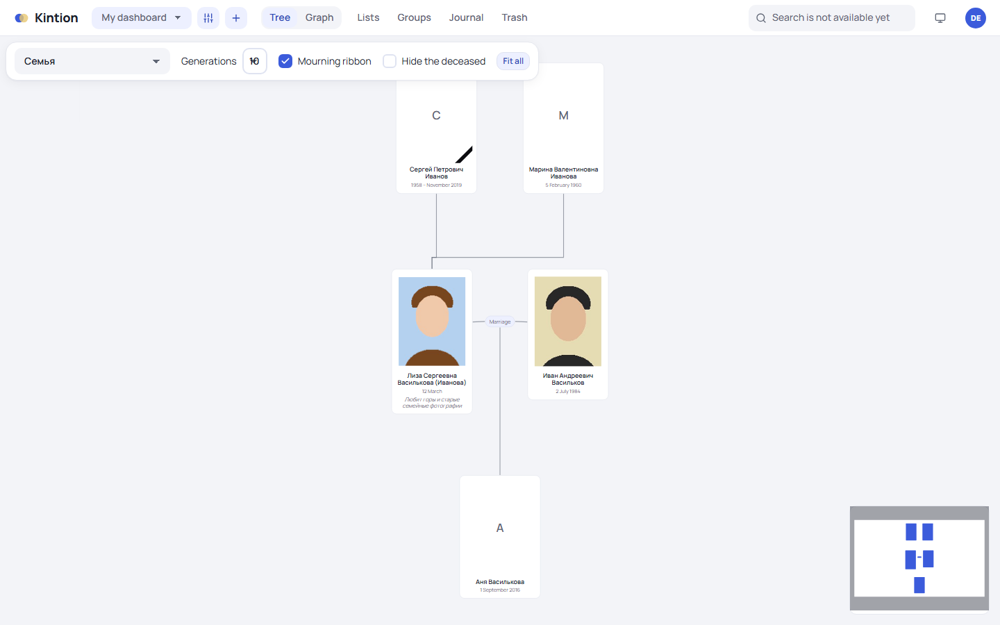
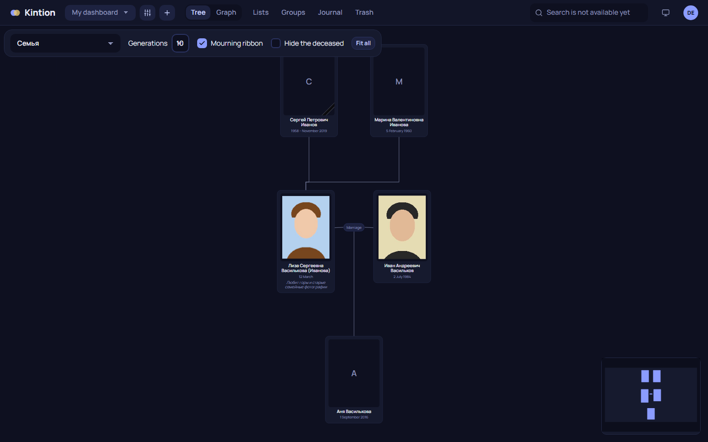
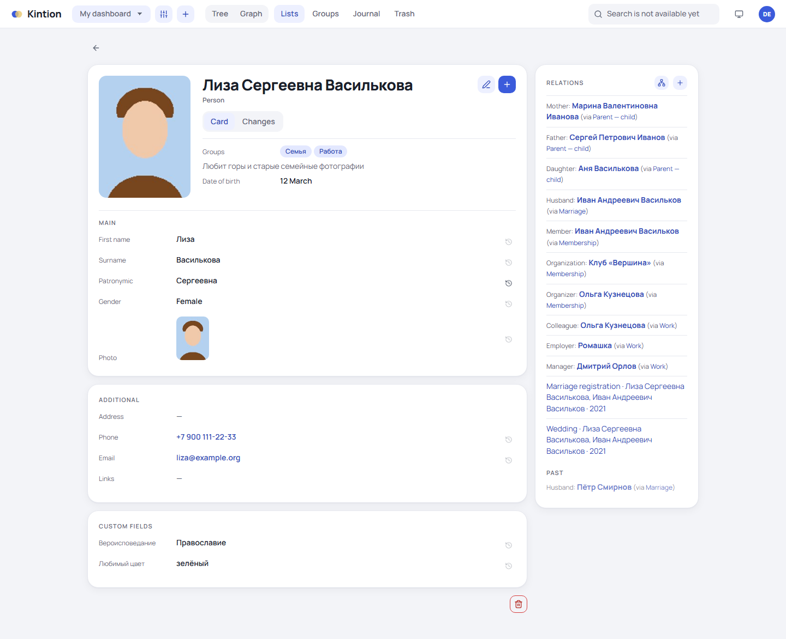
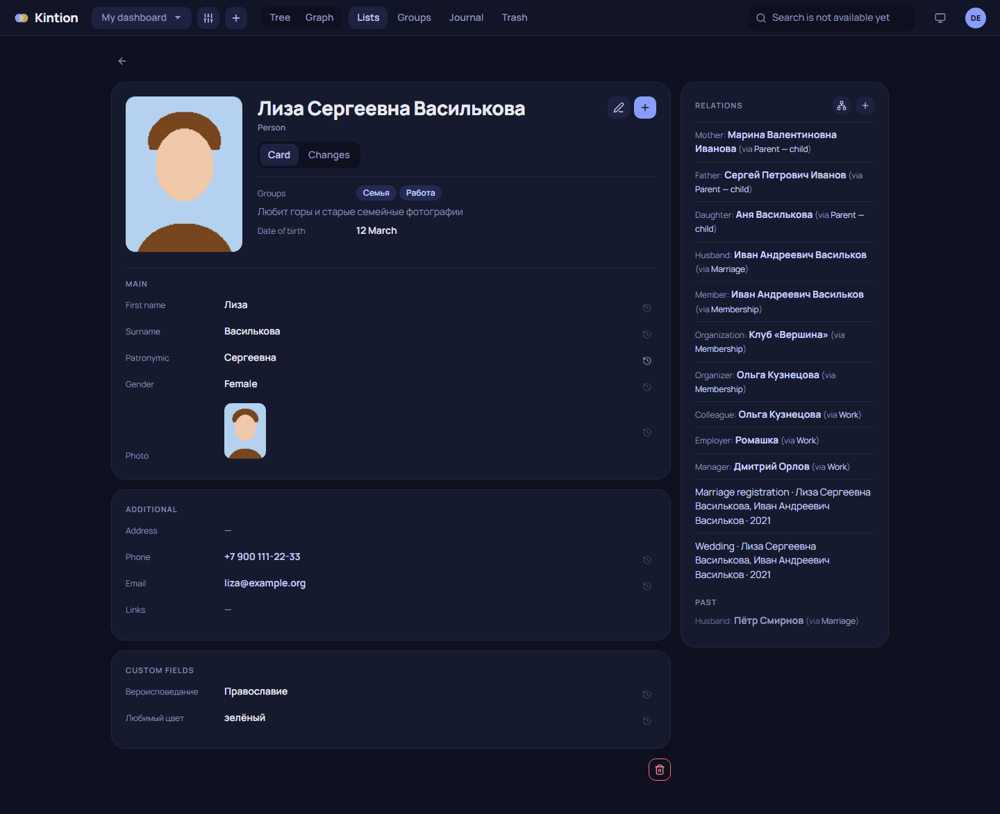
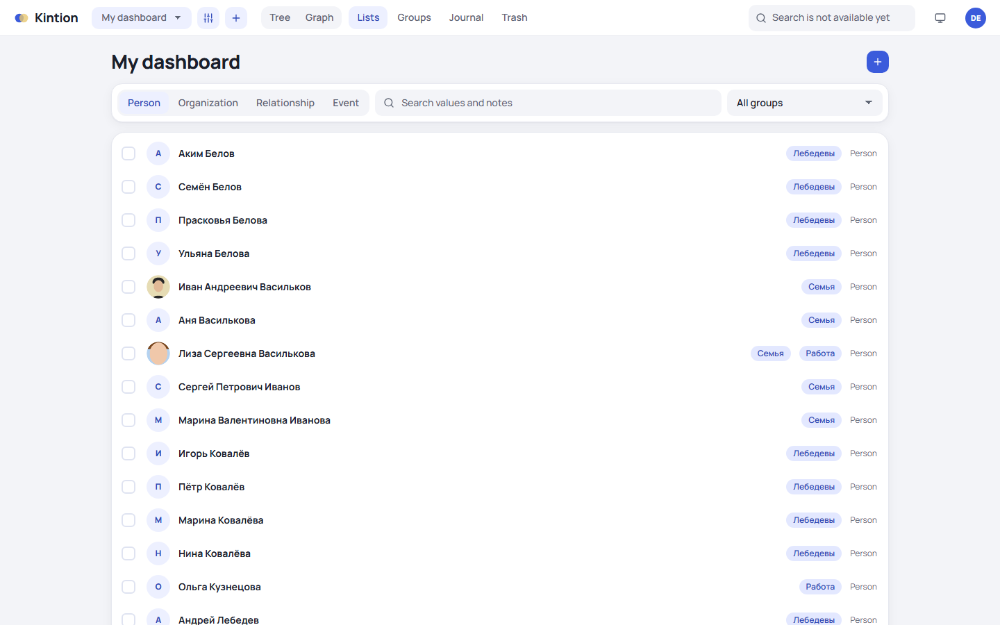
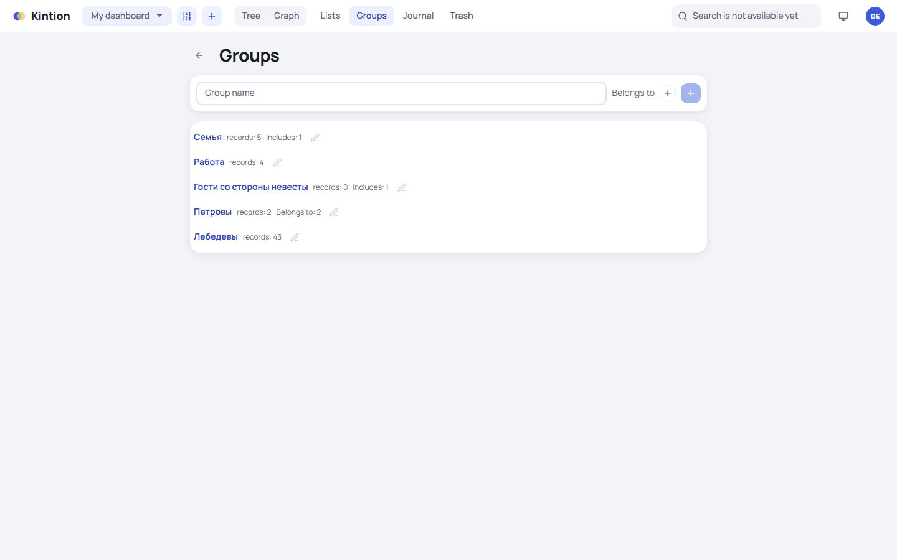
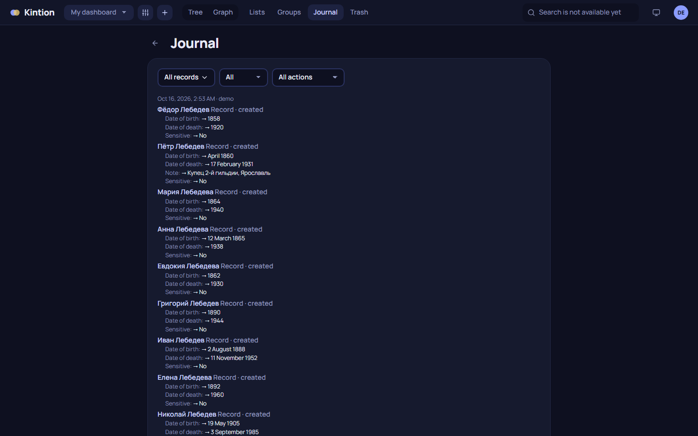
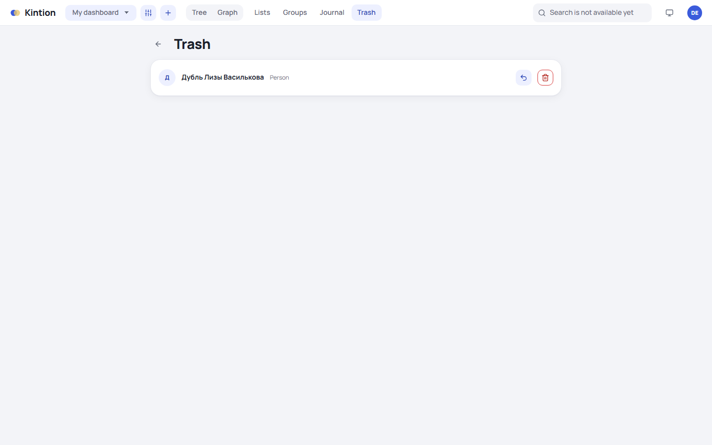
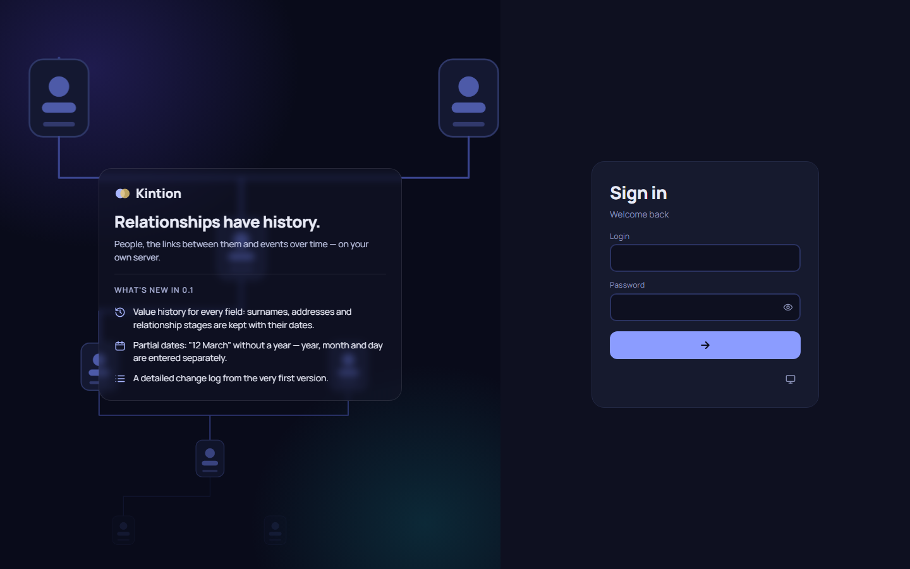

# Screenshots

Demo data, English interface (the sample names are Russian).

## Family tree

## Person card

Sections of fields with history (the clock icon opens the history of a value), the **Relations** panel on the right, and the **Changes** tab.

## Lists

## Groups

## Change log

## Trash

## Sign-in

